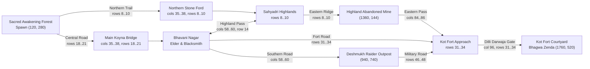

# Gate F — Step 1: World Architecture & Fog-of-War Documentation

## 1. World Dimensions & Coordinate Space

- **Primary Surface Region ID:** `sahyadri_gateway_valley`
- **Grid Dimensions:** `120 × 70` tiles (`16 × 16` world units per tile)
- **Total World Space:** `1920 × 1120` world units (`px`)
- **Logical Viewport:** `480 × 270` (`16:9` widescreen pixel-art canvas with integer scaling and `imageSmoothingEnabled = false`)
- **Fog-of-War Sector Grid:** `15 × 9` sectors (`8 × 8` tiles / `128 × 128` world units per sector = `135` total sectors)
- **Registered Interior Region (Metadata for Step 5):** `sahyadri_iron_cavern` (`40 × 25` tiles / `640 × 400` world units, `isInterior: true`, `playableInCurrentStep: false`, `entranceWorldPos: { x: 1360, y: 144 }`, `surfaceReturnPos: { x: 1360, y: 168 }`)

---

## 2. Non-Overlapping Sub-Zone Definitions

To prevent boundary ambiguity or duplicate zone triggers, the `120 × 70` surface grid (`cols 0..119`, `rows 0..69`) is partitioned into 7 mutually exclusive rectangular sub-zones in `data/world_regions.json`:

| Sub-Zone ID | Display Name | Tile Bounds (`x1, y1` → `x2, y2`) | World Pixel Bounds (`px`) | Key Landmarks & Encounters |
| :--- | :--- | :--- | :--- | :--- |
| `forest_clearing` | **Sacred Awakening Forest** | `(0, 0)` → `(29, 69)` | `(0, 0)` → `(479, 1119)` | Player Spawn `(120, 280)`, Field Smithing Anvil `(200, 300)`, Sagwan Teak & Hematite nodes, Deccan Scout `(420, 310)` |
| `river_crossing` | **Koyna River Valley** | `(30, 0)` → `(46, 69)` | `(480, 0)` → `(751, 1119)` | Koyna River (`cols 35..38`), Main Timber Footbridge (`rows 18..21`), Northern Shallow Stone Ford (`rows 8..10`) |
| `sahyadri_highlands` | **Sahyadri Highlands** | `(47, 0)` → `(76, 14)` | `(752, 0)` → `(1231, 239)` | Basalt cliff escarpment (`row 14`), Highland Pass (`cols 58..60`), Highland Iron Vein `(1040, 144)` |
| `abandoned_mine_approach` | **Highland Abandoned Mine Entrance** | `(77, 0)` → `(92, 37)` | `(1232, 0)` → `(1487, 607)` | Highland Abandoned Iron Mine Entrance `(1360, 144)`, Mine Ridge Iron Vein `(1312, 176)`, Eastern Mountain Road (`cols 84..86`) |
| `village_bhavani_nagar` | **Bhavani Nagar & Countryside** | `(47, 15)` → `(76, 37)` | `(752, 240)` → `(1231, 607)` | Village Elder `(860, 290)`, Master Blacksmith Forge `(980, 290)`, Village Stone Well `(col 55, row 23)` |
| `raider_outpost` | **Deshmukh Raider Outpost** | `(47, 38)` → `(92, 69)` | `(752, 608)` → `(1487, 1119)` | Raider Berserker `(940, 740)`, Camp Sniper `(1040, 720)`, Camp Shield Guard `(980, 780)` |
| `kot_fort_approach` | **Kot Fort Citadel & Approach** | `(93, 0)` → `(119, 69)` | `(1488, 0)` → `(1919, 1119)` | Western Dilli Darwaja Gate `(1536, 520)`, Citadel Halberdier & Iron Guard, Courtyard Spearman, Bhagwa Zenda Staff `(1760, 520)` |

---

## 3. Walkable Connectivity & Barrier Integrity

### Barrier Rules
1. **Outer Boundary Cliffs:** `rows 0..1`, `rows 68..69`, `col 0`, and `col 119` are solid (`collision = 1`).
2. **Koyna River (`cols 35..38`):** Impassable water (`collision = 2`) everywhere except the **Northern Stone Ford** (`rows 8..10`) and **Main Timber Footbridge** (`rows 18..21`).
3. **Sahyadri Highland Escarpment (`row 14, cols 47..92`):** Solid cliff barrier (`collision = 1`) except at the **Bhavani Nagar Highland Pass** (`cols 58..60`) and the **Eastern Mine-to-Fort Pass** (`cols 84..86`).
4. **Kot Fort Enclosure (`cols 96..115, rows 12..54`):**
   - Completely enclosed by solid fort walls (`cols 96, 115` and `rows 12, 54`) and flanking mountain cliffs along `col 96` (`rows 2..11` and `rows 55..67`).
   - The **only** entrance into the Kot Fort courtyard is the western **Dilli Darwaja Gate** (`col 96, rows 31..34`), which remains solid (`collision = 1`) until `state.worldState.villageLiberated` is achieved and the player interacts with `fort_gate_obj`.

---

## 4. Fog-of-War, Discovery XP & Map Modals

- **Sector Grid (`15 × 9`):** Each sector spans `8 × 8` tiles (`128 × 128` world units). Moving through the world reveals the `3 × 3` sector neighborhood around Shivaji and persists sector keys (`"sc_sr"`) in `state.worldState.discoveredCells`.
- **One-Time Sub-Zone Discovery Reward (`+25 XP`):** Entering any of the 7 named sub-zones for the first time appends its ID to `state.worldState.discoveredSubZones`, displays `DISCOVERED: <Region Name> (+25 XP)`, awards `+25 XP` via `gainXP(25)`, and saves immediately. Subsequent boundary crossings or save reloads never re-award XP.
- **HUD Minimap (`#minimapCanvas`):** Renders a live `30 × 18`-tile window centered on Shivaji using actual `groundTiles` data, masking unexplored sectors and undiscovered landmarks.
- **Strategic World Map (`#world-map-modal`, `[M]`):** Renders the full `120 × 70` surface terrain (`240 × 140` canvas), overlays fog-of-war on unexplored sectors, hides markers in undiscovered sectors, lists discovered regions (`X/7`) and sectors (`Y/135`), pauses world simulation while open, and closes with `M`, `Escape`, or `✕`.
